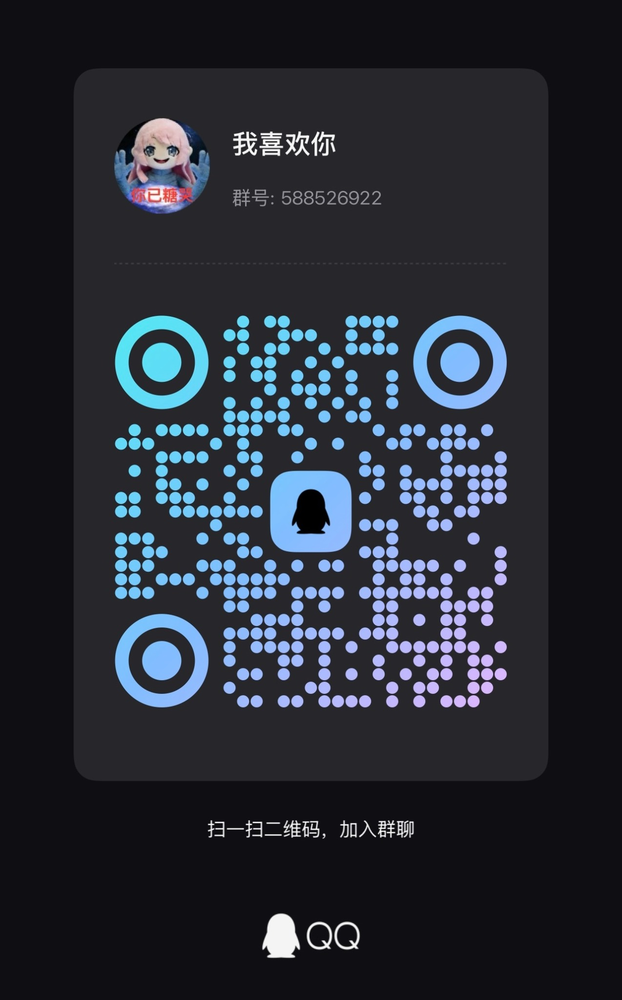

# AniLink

<div align="center">


[中文](README.md) | English
</div>

## Project overview

AniLink is an anime management plugin for [Obsidian](https://obsidian.md/). It brings anime discovery, subtitle-group RSS subscriptions, qBittorrent downloads, local playback, Bilibili danmaku, and Bangumi progress and reviews into one dashboard.

- Browse your anime shelf by season, collection status, title, or recently downloaded updates.
- Search Bangumi and find subtitle-group feeds through Mikan, or provide a custom RSS feed.
- Download episodes with qBittorrent and open local files in your configured player.
- Match Bilibili episode sources from selected uploaders, merge XML danmaku, and optionally align their timing with local audio.
- Update watched progress manually, save ratings and reviews, and push changes through the Bangumi task queue.
- Preview Bangumi, Fanku and rating trends, or open their websites.

Current release **1.0.15**, updated **2026-11-22**.

### Changes in 1.0.15

- Configurable dates and shelf ordering, updated Bangumi mirror, improved danmaku merging and playback notices, and better settings layout on narrow screens.

### Changes in 1.0.12

- Compact mobile controls, cards and detail panels, a single scroll surface, retained shelf position and room for the native bottom toolbar.
- Device-local connection and path overrides keep desktop and mobile configurations from replacing one another. Mobile availability counts only confirmed remote files.
- Fixed startup RSS refresh, torrent-file proxy routing and preview recovery. Opening the downloader refreshes subscriptions after its Web UI becomes ready.
- Added multiple library roots, explicit folder association, notification controls and optional completed-task cleanup that retains media files.
- Reused downloader sessions, bounded mobile metadata reads to four concurrent subjects and added Windows, macOS and Linux CI runners.

Mobile WebDAV playback depends on supported device formats. Authenticated media opens in a browser for login and playback. Mobile information tabs open websites directly because sites such as Fanku restrict iframe embedding. Physical iOS and Android testing remains necessary.

Desktop builds support Windows, macOS and Linux service connections, local players and platform-specific rclone installation. Startup scheduling and idle shutdown management currently use Windows scripts. Mobile uses the same cards and panels in a single-column shelf and vertically stacked detail view. General, page, Bangumi synchronization and WebDAV settings are available. Desktop downloader and audio-tool controls are hidden. The mobile entry point is tested without Node.js or Electron imports. Physical mobile devices, macOS and Linux still require end-to-end verification.

Author on Bilibili [北漠海](https://space.bilibili.com/1065768987). See the [changelog](CHANGELOG.md) for releases and the [Chinese documentation](README.md) for detailed configuration.

## Factory preferences

The shelf opens its first displayed show, previews Fanku and uses Obsidian Web viewer. Startup and exit Bangumi synchronization are enabled with conflict prompts. qBittorrent automatic refresh and completion notifications are disabled, the refresh interval is one minute, idle shutdown is five minutes, and unwatched revision upgrades are enabled. Watched-file cleanup and linked torrent deletion are enabled. Playback alignment, official and regional danmaku, and cut alignment are enabled. Remote services are disabled.

Credentials, executable paths, media directories and personal block rules are configured by each user. The initial WebUI endpoint is `http://127.0.0.1:8080`. Existing settings take precedence on upgrade. Windows login startup requires opting in.

## Quick start

### Install from GitHub Releases

1. Download `main.js`, `manifest.json` and `styles.css` from [Releases](https://github.com/beimohai/AniLink-Obsidian/releases/latest).
2. Place the three files in `.obsidian/plugins/anilink/` inside your vault.
3. Reload Obsidian and enable AniLink under Community plugins.
4. Open AniLink settings and configure your accounts, downloader and player.

AniLink is available in the Obsidian community plugin directory. For manual updates, replace the three release files and keep `data.json`. Audio and Windows scheduler helpers are bundled in `main.js` and extracted when their features run.

### Requirements

| Application or account | Purpose |
| --- | --- |
| Obsidian 1.15.0 or later | Desktop dashboard and a shared mobile interface |
| qBittorrent with Web UI and RSS enabled | Downloads and subscription rules |
| DanDanPlay, or another configured video player | Local playback |
| Python, NumPy and FFmpeg on PATH | Optional audio alignment |
| Bangumi access token | Collection, progress, rating and review synchronization |
| Bilibili login session | Access to authenticated searches, source audio and danmaku |

Install NumPy with `python -m pip install numpy`. Check that `python --version` and `ffmpeg -version` work in a terminal. DanDanPlay is recommended for video and companion XML danmaku. PotPlayer, mpv and VLC require their own danmaku support and have different automatic-loading behavior.

Other Obsidian plugins, ANI-RSS, AutoBangumi and public danmaku proxy services are optional integrations. The basic workflow uses qBittorrent directly.

### Configure connections

Enter your Bangumi token, qBittorrent executable, Web UI address, username and password, dedicated media directory, and player executable. The usual local Web UI address is `http://127.0.0.1:8080`. Configure its credentials in qBittorrent itself. This interface lets AniLink submit downloads and manage tasks and RSS rules.

Sign in to Bilibili using the QR login window and configure uploader UIDs as needed. A valid login does not guarantee that Bilibili will accept every request. HTTP 412 is a server-side restriction and can still occur.

## Watching workflow

1. Search for an anime and add it to your shelf with a collection status.
2. Choose the correct season, subtitle group, language and release format, then subscribe.
3. Keep qBittorrent running to check RSS and download new releases. AniLink displays locally available unwatched episodes.
4. Select an episode and play it. When alignment is enabled, AniLink matches source audio, calculates a reliable offset, prepares merged XML and starts the player afterwards.
5. After watching, use the manual progress action to mark episodes up to the selected one as watched.
6. Save your rating and review. Bangumi writes run through the background queue. Use Bangumi settings to push or pull and General settings to inspect logs.
7. The local progress-action preference controls whether to keep files, remove the current file or remove watched files. A separate Bangumi preference marks a fully watched season as completed. Dropping a show retains its existing directory/RSS cleanup behavior. Putting a show on hold pauses subscriptions and keeps files.

Cleanup deletes actual files. Configure a dedicated directory and review cleanup settings before use. qBittorrent RSS checks run only while qBittorrent is running. Windows startup is configured through the plugin settings and uses the bundled scheduler helpers.

## Storage and synchronization

Complete plugin data lives in `.obsidian/plugins/anilink/data.json` inside the vault. It includes shelf entries, progress, reviews, subscriptions, connection settings, credentials and queued tasks. Copy this file with the plugin folder to move your setup. Configure your synchronization tool to include community plugin settings or this file explicitly.

Older per-vault files under `%LOCALAPPDATA%/AniLink/` migrate automatically on upgrade and remain available for recovery. Local device identity and connection overrides stay outside the vault. Existing devices prefer their saved downloader, player, media-path and remote-service settings; new devices initially use the complete snapshot. Bangumi account settings remain in the shared data file.

Credentials in `data.json` are unencrypted. Use private synchronization storage and keep this file out of public repositories. Media files remain in the configured download directory. Website cookies are stored by Electron and can require another login on a different machine. Check executable and media paths after moving devices.

Field-level progress records merge independently across devices. Configure your own synchronization tool to include plugin data, and keep the complete data file in private storage.

## Customization and limitations

Plugin settings provide toolbar ordering, default season and sorting, shelf columns, search status actions, website opening mode, default information page, notifications, cleanup and audio alignment options.

Website previews depend on network access, website restrictions and the Obsidian Web viewer. Fanku matching may fall back to search when the correct entry cannot be determined. Bilibili lookup does not cover every uploader collection. Audio alignment reads only the first 180 seconds. Three initial samples can trigger one additional batch of three samples, with a maximum of six per source. At least three reliable anchors must agree. Sources with ambiguous timing are rejected. Audio reads time out after 45 seconds and the calibration process after 120 seconds. Mobile WebDAV playback depends on accessible media URLs, authentication sessions and device codec support.

The plugin accesses external media files, launches players and local audio tools, and reads the clipboard when the paste button is used. These permissions are needed by those features.

## Build from source

```bash
npm ci
npm run build
npm run lint
npm test
npm run check
npm run package
```

Use Node.js 24 and the committed lockfile. The production build generates `main.js`. Packaging prepares an installation directory under `dist/anilink/`. See [Development](docs/DEVELOPMENT.md) and [Testing](docs/TESTING.md).

## Sponsorship and support

If AniLink helps you manage your watching routine, you can support its maintenance. Thank you!


## Feedback and community

- [Report a problem or request a feature](https://github.com/beimohai/AniLink-Obsidian/issues)
- [Submit a pull request](https://github.com/beimohai/AniLink-Obsidian/pulls)
- [Author on GitHub](https://github.com/beimohai)
- [Author on Bilibili](https://space.bilibili.com/1065768987)
- QQ group **588526922**



Include your plugin and Obsidian versions, reproduction steps, expected behavior and actual result. Remove tokens, cookies, account information and private paths from logs before sharing them.

## License

Released under the [MIT License](LICENSE). External applications and services retain their own licenses and terms.
